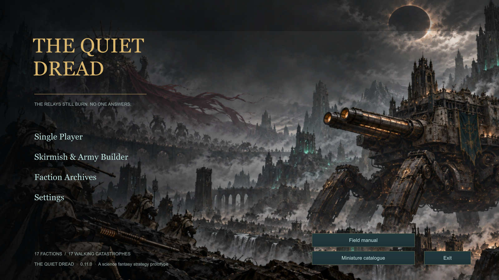
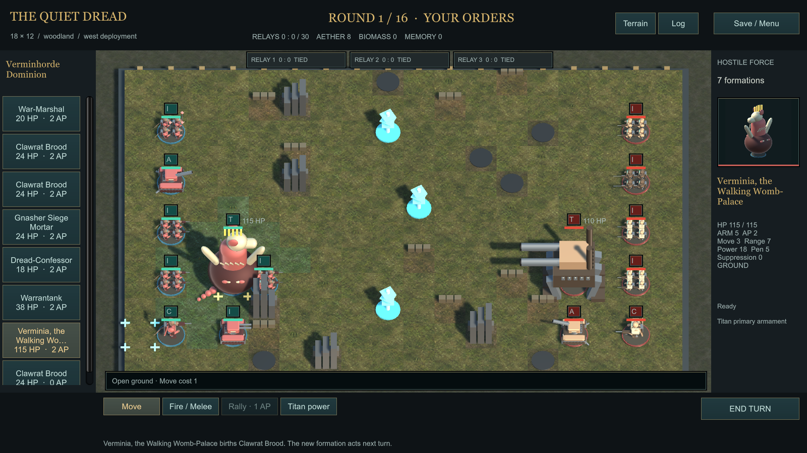
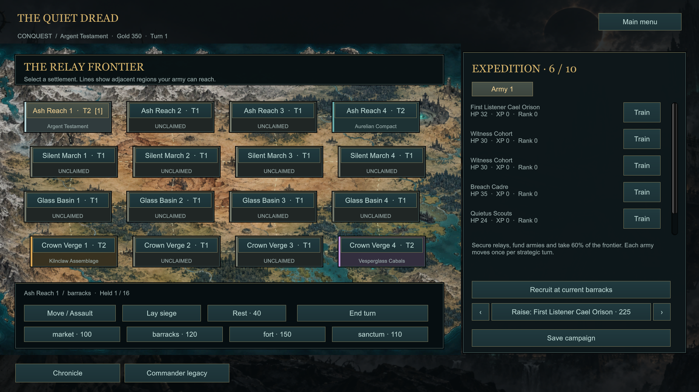

# The Quiet Dread

A native Windows science fantasy strategy prototype built in Unity. Lead armies of guns, artillery, sorcery and faction-specific titans through tactical battles, a roguelite **Trail of Death**, and territorial **Conquest**.

**Current version: 0.12.0 · Unity 6000.6.6f1 · Windows x64**

## Play and build

This repository contains the Unity source project. Generated builds and Unity caches are excluded.

1. Clone this repository: `git clone https://github.com/MrKrisSatan/TQD.git`
2. Install Unity **6000.6.6f1** with Windows Build Support through Unity Hub.
3. Add the cloned repository folder as a project in Unity Hub.
4. On Windows, run `powershell -ExecutionPolicy Bypass -File .\Build.ps1`. If Unity is installed elsewhere, adjust the editor path in that script.
5. Run `Launch.cmd`, or open `Build/Windows/The Quiet Dread.exe`.

The build entry point is `BuildGame.Build`. It runs editor validation before producing the Windows player. The optional local narrator requires a separately installed Ollama instance and a local model; the game has authored offline narration when it is disabled or unavailable.

## In the game

- **17 factions, 51 commanders, 243 unit profiles and 17 faction titans**, with faction lore and army-building choices.
- Tabletop-inspired tactical combat: actions, armour penetration, cover, line of sight, suppression, artillery deployment and blast damage, and resource-driven magic.
- Three battlefield sizes and four player deployment sides; woodland, wetlands and ruined cities. Water restricts ordinary ground movement and marsh slows most units.
- **Trail of Death:** start with three units, choose a procedural route through three acts, recruit and train survivors, and defeat the final boss. Permanent losses matter.
- **Commander legacies:** ten victory milestones per commander, with personal rewards usable by that commander in both campaigns. Verminhorde progression includes Gore-Maidens and the God-Queen.
- **Conquest:** a 16-province campaign with rival armies, recruitment, buildings, sieges and territorial control.
- Optional local AI campaign chronicles grounded in recorded battle outcomes, casualties and survivors.
- Five streamed music tracks, campaign-specific ambience, battle playlists, crossfades and separate music/effects controls.

## Development status

This is a playable prototype under active development. Models use original modular procedural geometry; many still share underlying parts. Bespoke sculpts, animation, balance, AI coordination, accessibility and long-session testing remain substantial work. The main next milestone is a polished benchmark battle between Verminhorde Dominion and Kharad Vault Concord.

The v0.12 build recorded **2,959 passing editor checks**, plus a dedicated runtime audio smoke test. Earlier runtime QA covers the gameplay loop and model gallery. These are local validation results, not a claim of exhaustive balance or clean-machine testing.

- [Development To-Do list](Documentation/TODO.md)
- [Astra continuation prompt, including the To-Do list](Documentation/ASTRA-HANDOFF-PROMPT.md)
- [Native tabletop rules](Documentation/NATIVE-RULES.md)
- [Commander rewards](Documentation/COMMANDER-REWARDS.md)
- [Faction codices](Documentation/Codices)
- [Local narrator setup](Documentation/LOCAL-NARRATOR.md)
- [Music setup and provenance](Documentation/MUSIC.md)
- [Latest release notes](Documentation/RELEASE-0.12.md)
- [Music validation](Documentation/MUSIC-QA.md)
- [Earlier QA report](Documentation/QA-REPORT.md)

## Project layout

`Assets/Scripts` contains the native rules, campaigns, AI, presentation, procedural miniatures and narrator. `Assets/Resources` holds roster data, reward tracks, illustrations and music. `Assets/Editor` contains the build entry point and validation suites. `Documentation` holds the design, references and roadmap.

Some historical documentation records paths from the original development computer. Use the cloned repository root on your own machine. `Tools/import-content.cjs` is a historical import tool that depends on the earlier Ashcrown project; it is not required to build the checked-in Unity project.

## References and assets

The setting draws inspiration from science fantasy tabletop games. SOVL was a gameplay and visual reference; this project is **The Quiet Dread**, an independent prototype, and is not affiliated with SOVL, Games Workshop or One Page Rules. Verminhorde material was adapted from the user-supplied codex; source mappings distinguish adaptations from reference material.

See [asset provenance](Documentation/ART-PROVENANCE.md) and [codex mappings](Documentation/Legacy/CODEX-MAPPING.md). The original SOVL archive and reference PDF are not included. Music was supplied by the project owner; filenames and hashes are documented without claiming ownership or a redistribution licence. No blanket open-source licence has been selected for this repository.
